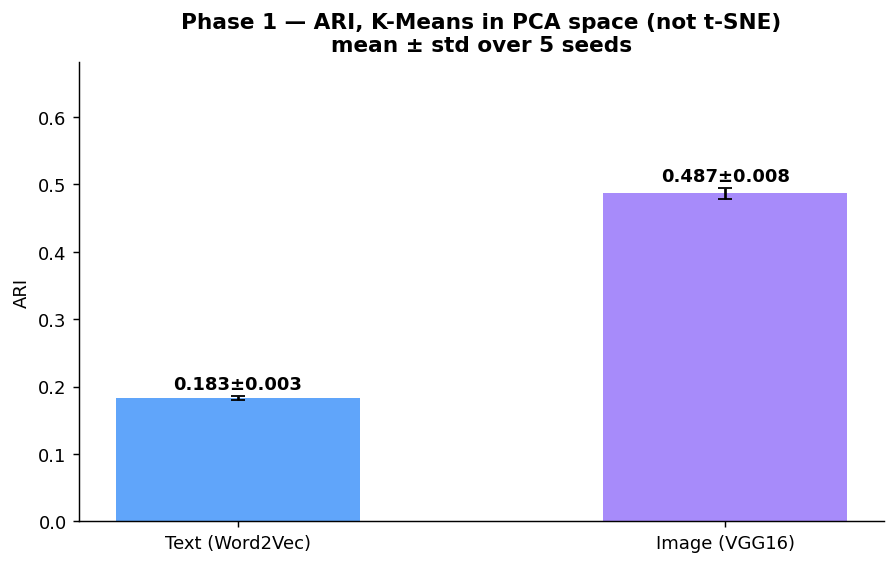
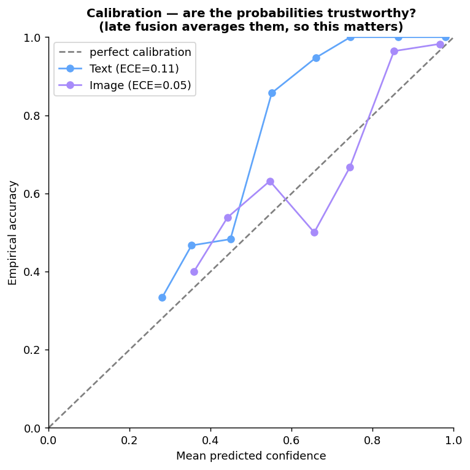

# Multimodal Product Classification — NLP + Computer Vision

> Can a product's **category** be recovered automatically from its text description and its photo — with no manual labelling?
> A feasibility study comparing **6 text** and **2 image** feature-extraction methods on 1,050 Flipkart products — then supervised fusion, and a **2026 CLIP zero-shot** re-run.


*OpenClassrooms Data Scientist — Project 6 · 2023*

🇫🇷 [Version française](#-version-française) · 🇬🇧 [English below](#-english)

---

## 🇬🇧 English

### The 30-second summary — one question, three eras

Built in 2023, revisited in 2026. Same question, same 1,050 products, same 7
balanced categories. Every number below is a **mean ± std over 5 seeds**
(5-fold CV for the supervised rows) — no single lucky split.

| Era · regime | Method | Metric | Score | What it shows |
|---|---|---|:--:|---|
| **2023 · unsupervised** | Word2Vec / VGG16 | ARI | 0.18 / 0.49 | category signal per source, no labels |
| **2023 · supervised** | Word2Vec+VGG16, late fusion | Accuracy | 0.89 | how well we classify, with labels |
| **2026 · CLIP zero-shot** | CLIP, one shared space, no training | Accuracy | 0.72 | what you get with zero labels |
| **2026 · CLIP supervised** | CLIP embeddings + a trained head | Accuracy | **0.95** | the real upgrade — same supervision, better features |

**How to read this — and what you may NOT compare.** Accuracy and ARI are
different metrics on different regimes; "0.18 (ARI)" next to "0.95 (accuracy)"
would be meaningless. Every comparison below is **like-for-like**:

- **Did CLIP improve on my 2023 method, unsupervised?** → **ARI vs ARI**, same
  PCA-clustering protocol. Text **0.18 → 0.47**, image **0.49 → 0.54**. CLIP's
  shared-space text embedding is the big jump.
- **Did CLIP improve it, supervised?** → **accuracy vs accuracy**, same 5-fold
  CV. Trained head: **0.89 (Word2Vec+VGG16) → 0.95 (CLIP)**. Same supervision,
  better features — exactly the 2025 literature's finding.
- **Can zero-shot replace a trained model?** CLIP zero-shot 0.72 vs trained 0.95.
  No — but 72% with **no labels at all** changes the cost of a cold start.


---

### The question

An e-commerce marketplace lists products that sellers categorise by hand —
slow, inconsistent, error-prone. **Could categories be assigned automatically**
from what we already have: a text description and a photo? This project answers
that *before* building a production classifier, by measuring how much category
signal each data source actually carries.

### Approach — an honest, unsupervised benchmark

Rather than jump to a supervised model, I treated it as a **feasibility study**:
extract features from each modality, cluster into 7 groups, and score the
clusters against the true categories with the **Adjusted Rand Index** (0 =
random, 1 = perfect). No labels build the features — they only score them.

**One rigour fix vs 2023.** The original study clustered on a *t-SNE* projection.
t-SNE is built for *visualisation*: it's stochastic and distorts global
distances, so clustering on it flatters the score. The honest protocol clusters
in **PCA space** (distance-preserving) and keeps t-SNE for the pictures only:

```
reference metric : features → standardize → PCA → K-Means (k=7) → ARI   (5 seeds, mean ± std)
figures only     : features → t-SNE (2D)                                  (visualisation)
```

### Results — the relative ranking (t-SNE, 2023)

This benchmark of 8 feature methods used the 2023 t-SNE protocol. The **absolute
values are inflated by t-SNE** (see the note below); keep it for the *ranking*,
which still holds — learned embeddings beat hand-crafted ones.

| Modality | Method | ARI (t-SNE, 2023) |
|---|---|:--:|
| Text | CountVectorizer (bag-of-words) | 0.333 |
| Text | TF-IDF | 0.240 |
| **Text** | **Word2Vec** | **0.475** 🏆 |
| Text | BERT (`bert-base-uncased`, [CLS]) | 0.182 |
| Text | BERT (TF-Hub) | 0.289 |
| Text | USE (Universal Sentence Encoder) | 0.423 |
| Image | SIFT (bag-of-visual-words) | 0.053 |
| **Image** | **CNN — VGG16 transfer learning** | **0.460** 🏆 |


> **t-SNE inflated the scores — the reproducible PCA numbers are lower.**
> Re-run with clustering in **PCA space** (5 seeds, mean ± std), the two winners
> drop to **Word2Vec ARI 0.18 ± 0.00 (text)** and **VGG16 ARI 0.49 ± 0.01
> (image)**. Text falls hard (0.475 → 0.18): t-SNE had been separating text
> clusters it couldn't really separate. Image barely moves (0.46 → 0.49). This
> is the honest baseline the CLIP comparison below uses.



> **Why these also differ from my 2023 slides (USE 0.49, VGG16 0.47).** Back then
> seeds weren't fixed, so numbers moved every run and the "best" text model
> flipped between runs. Fixed seeds + PCA clustering = stable, reproducible. I'll
> take a number I can reproduce over one I can't.

### What the numbers say

- **Feasibility: yes**, but mostly from images. In honest PCA space, image
  (0.49) carries far more category signal than text (0.18) — the opposite of
  what t-SNE suggested.
- **Simpler beat heavier on this data.** Word2Vec outscored frozen BERT.
  Product descriptions are keyword bags, not sentences, so BERT's contextual
  strength goes unused when frozen. *Match the model to the data, not to the hype.*
- **Transfer learning is the unlock for images.** VGG16 (0.460) vs SIFT (0.053) —
  a ~9× gain. Learned features transfer across domains; hand-crafted ones don't.
- **The two modalities are complementary** (text ≈ image), which is the case for
  fusing them — tested in phase 2 below.

### Phase 2 — supervised classification & fusion

Phase 1 asks *"is the signal there?"*. Phase 2 asks *"how well can we classify?"*
— a sweep (LogReg / SVM / Random Forest), best model kept per modality, then four
fusion strategies. Evaluated with **repeated stratified 5-fold CV over 5 seeds**,
so every number is a **mean ± std**, not one lucky split.

> **On the choice of metric.** The 7 classes are perfectly balanced (150 each),
> so accuracy is *not* misleading here and tracks macro-F1 closely. I still
> report **macro-F1 as the reference metric**: the right senior reflex, and it
> surfaces a weak class that plain accuracy would hide.

**Two ways to fuse text and image — not the same bet:**

- **Early fusion** glues the two feature vectors end to end (concat), then one
  model classifies. The catch: the two live on different scales and densities, so
  weak dimensions dilute strong ones — it lands *below* image-only.
- **Late fusion** keeps one classifier per modality and combines their *outputs*.
  Simplest: average the probabilities. Smarter: let a small model learn the
  combination (*stacking* = a meta-classifier on the two models' probabilities).

| Features | Classifier | Accuracy | Macro-F1 |
|---|---|:--:|:--:|
| Text — Word2Vec | LogReg | 0.846 ± 0.022 | 0.843 ± 0.024 |
| Image — VGG16 | SVM | 0.857 ± 0.022 | 0.855 ± 0.022 |
| Early fusion (concat) | LogReg | 0.842 ± 0.025 | 0.841 ± 0.025 |
| **Late fusion (avg proba)** | — | **0.889 ± 0.021** | **0.887 ± 0.021** |
| Weighted fusion | — | 0.889 ± 0.019 | 0.887 ± 0.020 |
| Stacking (meta-LogReg) | — | 0.889 ± 0.017 | 0.887 ± 0.018 |


What the numbers say, error bars included:

- **The model sweep pays off.** SVM beats LogReg on images by several points — no
  settling for one classifier.
- **Early fusion hurts.** Concatenating 300-d text and 200-d image features
  (0.842) lands *below* image-only (0.857). *Fusion is a modelling decision, not
  an `np.hstack`.*
- **Late fusion is the real gain, but read the error bars.** It reaches **0.889 ±
  0.02** vs image-only **0.857 ± 0.02** — about +3 points, and the bands partly
  overlap, so I state it as a *modest, consistent* gain, not a blowout. The three
  late-style fusions (avg / weighted / stacking) all land at 0.889: once you
  combine at the decision level, the exact recipe barely matters.
- **Why not more? Error overlap.** On the reference fold, text and image are both
  right on 168/210 and both wrong on 17. Only **~12%** are cases where exactly
  one modality is right — the only ones fusion can fix. That caps the gain; it's
  structural, not a tuning failure. See [notebook 02](notebooks/02_supervised_fusion.ipynb).


> **Is averaging probabilities even legitimate?** Late fusion averages the two
> models' probabilities — which only makes sense if they're calibrated. Checked:
> **ECE 0.05 for the image model (well calibrated), 0.11 for text (less so).**
> So the image votes are trustworthy, text slightly over-confident — a reason the
> learned stacking doesn't beat a plain average here.



> **Reproducibility note.** Everything is re-run with **5 fixed seeds** and
> reported as mean ± std; clustering happens in PCA space and supervised scores
> come from repeated 5-fold CV. One subtlety: Word2Vec is only deterministic with
> `workers=1` — with several workers the training order varies and metrics drift
> ~1 point between runs, seed or no seed. All numbers live in
> [`results_supervised.json`](results_supervised.json) and
> [`results_clip_zeroshot.json`](results_clip_zeroshot.json).

### The 2026 angle — CLIP zero-shot, actually run

The project is from 2023; the field moved fast. Instead of a design note, I
**ran** the modern approach on the same 1,050 products and measured it.

The idea: **CLIP** puts text and image in *one* shared vector space, so the whole
early-vs-late fusion problem disappears — and you can classify **zero-shot**, by
embedding the category *names* and taking the nearest one. No training, no
labels, three lines.

**(a) Zero-shot — no training at all.** Embed the category *names*, embed each
product, assign the nearest. Three lines, zero labels.

| CLIP zero-shot | Training | Accuracy | Macro-F1 |
|---|:--:|:--:|:--:|
| Text only | none | 0.635 | 0.636 |
| Image only | none | 0.691 | 0.673 |
| **Image + text** | **none** | **0.722** | **0.713** |


Zero-shot reaches **72% on 7 classes with no labelled example**. It doesn't beat
a trained model — but for a cold-start catalogue, 72% out of the box changes the
cost of collecting a training set.

**(b) Supervised head on CLIP — the apples-to-apples upgrade.** Zero-shot vs the
2023 pipeline changes two things at once (encoder *and* supervision). To isolate
"are CLIP features better *at equal supervision*?", I trained the **same kind of
head, same 5-fold CV** on CLIP embeddings:

| Supervised, same CV protocol | Accuracy | Macro-F1 |
|---|:--:|:--:|
| 2023 — Word2Vec + VGG16, late fusion | 0.889 ± 0.021 | 0.887 ± 0.021 |
| CLIP image | 0.900 ± 0.016 | 0.899 ± 0.017 |
| CLIP text | 0.952 ± 0.017 | 0.952 ± 0.018 |
| **CLIP image + text** | **0.953 ± 0.018** | **0.953 ± 0.018** |

Same supervision, better features: **0.889 → 0.953** (+6 points). CLIP *text*
alone (0.952) already beats the best 2023 fusion. This is the clean result — and
it matches the 2025 literature, which finds CLIP + a late-fusion head the winner
on this exact task.

**Like-for-like, unsupervised (ARI, PCA protocol, mean ± std):**

| Unsupervised (ARI) | 2023 | 2026 — CLIP |
|---|:--:|:--:|
| Text | Word2Vec 0.18 | **0.47 ± 0.02** |
| Image | VGG16 0.49 | **0.54 ± 0.02** |
| Text + image (shared space) | *n/a in 2023* | **0.68 ± 0.03** |

The text jump (0.18 → 0.47) is the headline: CLIP's shared space finally makes
product text carry real category signal.

**Two honest negatives, reported not hidden:**

- **CLIP's text encoder caps at 77 tokens** (Flipkart descriptions reach ~700).
  I tried **chunk-and-pool** (encode 77-token chunks, average them) to recover
  the tail — it **didn't help** (0.635 → 0.631 zero-shot). The category signal
  sits in the first tokens; the tail is mostly noise here. A negative result is
  still a result.
- **Zero-shot ≠ supervised.** 0.72 vs 0.95 — the gap is the price of using no
  labels.

What I'd **keep** from 2023: the fair shared protocol, fixed seeds, a held-out
test set, and reporting negative results honestly. Modern models change the
*tools*, not the *rigour*.

### Tech stack

**NLP** — NLTK (tokenise, stop-words, Porter stemming, WordNet lemmatisation),
scikit-learn (CountVectorizer, TF-IDF), gensim (Word2Vec), Hugging Face
Transformers (BERT), TensorFlow Hub (USE).
**Computer Vision** — OpenCV (SIFT), TensorFlow / Keras (VGG16 transfer learning).
**ML & viz** — scikit-learn (PCA, t-SNE, K-Means, ARI), pandas, matplotlib, seaborn.
**2026 multimodal** — Sentence-Transformers / CLIP (`clip-ViT-B-32`), PyTorch (zero-shot).

### Repository structure

```
p6-product-classification-nlp-cv/
├── README.md                                   # this file
├── requirements.txt                            # pinned dependencies
├── LICENSE                                      # MIT
├── results_supervised.json                     # phase-2 metrics (reproducible)
├── results_clip_zeroshot.json                  # 2026 CLIP zero-shot metrics
├── notebooks/
│   ├── 01_product_classification_text_image.ipynb   # phase 1 — unsupervised benchmark
│   ├── 02_supervised_fusion.ipynb                   # phase 2 — supervised + fusion
│   └── 03_modern_2026_approach.ipynb                # phase 3 — CLIP zero-shot (2026)
├── src/
│   ├── run_supervised.py                       # phase 1 (ARI/PCA) + phase 2 (5-fold CV, calibration)
│   └── run_clip_zeroshot.py                    # phase 3 — CLIP zero-shot + supervised head
├── data/
│   └── README.md                               # how to fetch the dataset (not versioned)
└── docs/
    ├── articles/README.md                      # references (the 2025 paper, cited)
    ├── *.html                                  # rendered notebooks (read without Jupyter)
    └── figures/                                # charts used in this README
```

### Reproduce

```bash
python -m venv .venv && source .venv/bin/activate
pip install -r requirements.txt
# fetch the dataset — see data/README.md
jupyter lab notebooks/01_product_classification_text_image.ipynb
```

> **Note.** Raw images (~1,050 files), the USE/CLIP models and the virtual
> environment are **not** versioned — see [`data/README.md`](data/README.md).
> The showcase notebooks are written to be *read*; HTML renders are in
> [`docs/`](docs/).

### What the 2025 literature says

The approach here isn't a lucky guess. A 2025 study on exactly this problem —
multimodal e-commerce product categorization at scale (271,700 products, 40
platforms) — tested early, late, and attention fusion over RoBERTa, ViT and
**CLIP**, and found **CLIP embeddings with an MLP late-fusion head gave the best
hierarchical F1 (98.59%)**, beating single-modality baselines. Same direction I
landed on at small scale: CLIP as the shared space, late fusion over early. They
also report a deployment trade-off worth keeping in mind — late fusion maxes
accuracy with diverse training data, early fusion generalises better to unseen
platforms. See [References](#references). *(Paper summary rephrased for
licensing compliance.)*

### 🏭 What I'd ship in production (2026)

This repo is a feasibility study. A production categoriser for a real catalogue
would look like this — and most of it is a short step from what's here:

- **CLIP embeddings as the backbone + a trained head.** Already the winner here
  (0.95) and in the 2025 literature. No more two separate encoders.
- **Cold start with no labels → cluster-then-label.** Cluster the CLIP
  embeddings (UMAP + HDBSCAN, as the 2025 paper does for category *discovery*),
  have a human validate the clusters, then switch to the supervised head once
  labels exist. Zero-shot (0.72) covers day one.
- **Hierarchical categories.** Real catalogues are trees (Clothing > Shoes >
  Sneakers), not 7 flat classes. A hierarchical head with consistency masking
  keeps parent/child predictions coherent.
- **Two-stage serving for cost.** A light text-only model clears the easy 90%;
  the heavier multimodal model only runs on the ambiguous cases. Accuracy where
  it matters, cheap everywhere else.

### 🔎 Critical review — what's still imperfect

- **t-SNE still used for the 8-method ranking.** The reference metric now
  clusters in PCA space (honest), but the phase-1 ranking table is still the 2023
  t-SNE run. For strict rigour I'd re-run all 8 methods in PCA — I re-ran only the
  two winners (Word2Vec, VGG16).
- **KMeans assumes convex clusters.** If I doubted linear separability I'd use
  **spectral clustering or HDBSCAN**, not t-SNE-then-KMeans (which cheats). UMAP
  for the non-linear reduction, kept out of the metric.
- **Frozen features.** Word2Vec/VGG16/CLIP are all used frozen. End-to-end
  fine-tuning is the untested path to more.
- **Single dataset, 1,050 products.** Small and clean. The real test is scale and
  messier catalogues.

### 🔜 To-do next

- **CLIP + a late-fusion MLP head** (as in the 2025 paper) instead of a plain
  average — likely the last few points.
- **Fine-tune** a backbone end-to-end rather than freezing it.
- **Hierarchical classification** on the full `product_category_tree`.
- Re-run the full 8-method ARI benchmark in PCA space for a fully consistent
  phase 1.

### References

- Q. Han et al., *Cross-Platform E-Commerce Product Categorization and
  Recategorization: A Multimodal Hierarchical Classification Approach*, 2025.
  arXiv:[2508.20013](https://arxiv.org/abs/2508.20013) ·
  doi:[10.48550/arXiv.2508.20013](https://doi.org/10.48550/arXiv.2508.20013).
  See [`docs/articles/README.md`](docs/articles/README.md).
- Dataset — [Flipkart products](https://www.kaggle.com/datasets/PromptCloudHQ/flipkart-products) (public, CC0).

---

## 🇫🇷 Version française

### Le résumé en 30 secondes — une question, trois époques

Construit en 2023, revisité en 2026. Même question, mêmes 1 050 produits, mêmes 7
catégories équilibrées. Chaque chiffre ci-dessous est une **moyenne ± écart-type
sur 5 seeds** (validation croisée 5-fold pour le supervisé) — pas un split
chanceux unique.

| Époque · régime | Méthode | Métrique | Score | Ce que ça montre |
|---|---|---|:--:|---|
| **2023 · non supervisé** | Word2Vec / VGG16 | ARI | 0,18 / 0,49 | signal « catégorie » par source, sans labels |
| **2023 · supervisé** | Word2Vec+VGG16, late fusion | Accuracy | 0,89 | à quel point on sait classer, avec labels |
| **2026 · CLIP zero-shot** | CLIP, espace partagé, sans entraînement | Accuracy | 0,72 | ce qu'on obtient avec zéro label |
| **2026 · CLIP supervisé** | embeddings CLIP + tête entraînée | Accuracy | **0,95** | le vrai gain — même supervision, meilleures features |

**Comment lire — et ce qu'on ne peut PAS comparer.** Accuracy et ARI sont des
métriques différentes sur des régimes différents ; mettre « 0,475 (2023) » à côté
de « 0,716 (2026) » n'aurait aucun sens. Ci-dessous, chaque comparaison est **à
régime égal** :

- **CLIP a-t-il amélioré ma méthode de 2023, non supervisé ?** → **ARI vs ARI**,
  même protocole de clustering en PCA. Texte **0,18 → 0,47**, image **0,49 →
  0,54**. L'embedding texte dans l'espace partagé de CLIP, c'est le gros saut.
- **CLIP a-t-il amélioré, supervisé ?** → **accuracy vs accuracy**, même CV
  5-fold. Tête entraînée : **0,89 (Word2Vec+VGG16) → 0,95 (CLIP)**. Même
  supervision, meilleures features — exactement le constat de la littérature 2025.
- **Le zero-shot remplace-t-il un modèle entraîné ?** CLIP zero-shot 0,72 vs
  entraîné 0,95. Non — mais 72 % **sans aucun label** change le coût d'un
  démarrage à froid.


---

### La question

Une marketplace e-commerce repose sur des catégories saisies à la main par les
vendeurs — lent, incohérent, source d'erreurs. **Peut-on attribuer la catégorie
automatiquement** à partir de ce qu'on a déjà : une description texte et une
photo ? Ce projet y répond *avant* de construire un classifieur de production,
en mesurant la quantité de signal « catégorie » que porte chaque source.

### Démarche — un benchmark non supervisé, honnête

Étude de faisabilité : extraire des features par modalité, les clusteriser en 7
groupes, et noter les clusters contre les vraies catégories avec l'**Adjusted
Rand Index** (0 = aléatoire, 1 = parfait). Aucun label ne construit les
features — ils ne servent qu'à noter.

**Une correction de rigueur vs 2023.** L'étude d'origine clusterisait sur une
projection *t-SNE*. Or t-SNE est fait pour la *visualisation* : stochastique et
déformant les distances globales, il flatte le score. Le protocole honnête
clusterise en **espace PCA** (qui préserve les distances) et garde t-SNE pour les
images seulement :

```
métrique de référence : features → standardize → PCA → K-Means (k=7) → ARI   (5 seeds, moy ± σ)
figures seulement      : features → t-SNE (2D)                                 (visualisation)
```

### Résultats — le classement relatif (t-SNE, 2023)

Ce benchmark de 8 méthodes utilise le protocole t-SNE 2023. Les **valeurs
absolues sont gonflées par t-SNE** (voir la note) ; on le garde pour le
*classement*, qui tient toujours — les embeddings appris battent l'artisanal.

| Modalité | Méthode | ARI (t-SNE, 2023) |
|---|---|:--:|
| Texte | CountVectorizer (sac de mots) | 0,333 |
| Texte | TF-IDF | 0,240 |
| **Texte** | **Word2Vec** | **0,475** 🏆 |
| Texte | BERT (`bert-base-uncased`, [CLS]) | 0,182 |
| Texte | BERT (TF-Hub) | 0,289 |
| Texte | USE (Universal Sentence Encoder) | 0,423 |
| Image | SIFT (sac de mots visuels) | 0,053 |
| **Image** | **CNN — VGG16 transfer learning** | **0,460** 🏆 |


> **t-SNE gonflait les scores — les chiffres PCA reproductibles sont plus bas.**
> Ré-exécuté avec clustering en **espace PCA** (5 seeds, moy ± σ), les deux
> gagnants tombent à **Word2Vec ARI 0,18 ± 0,00 (texte)** et **VGG16 ARI 0,49 ±
> 0,01 (image)**. Le texte chute fort (0,475 → 0,18) : t-SNE séparait des
> clusters texte qu'il ne séparait pas vraiment. L'image bouge à peine (0,46 →
> 0,49). C'est la baseline honnête qu'utilise la comparaison CLIP plus bas.


> **Pourquoi ça diffère aussi de mes slides 2023 (USE 0,49, VGG16 0,47).** À
> l'époque les seeds n'étaient pas figés : les chiffres bougeaient et le
> « meilleur » modèle texte changeait d'un run à l'autre. Seeds figés + clustering
> PCA = stable et reproductible. Je préfère un chiffre que je peux refaire.

### Lecture des résultats

- **Faisabilité : oui**, mais surtout grâce à l'image. En espace PCA honnête,
  l'image (0,49) porte bien plus de signal que le texte (0,18) — l'inverse de ce
  que suggérait t-SNE.
- **Le simple bat le lourd sur ces données.** Word2Vec dépasse BERT gelé. Les
  descriptions produits sont des sacs de mots-clés, pas des phrases : la force
  contextuelle de BERT, utilisé gelé, ne sert à rien. *On choisit le modèle selon
  la donnée, pas selon la mode.*
- **Le transfer learning débloque l'image.** VGG16 vs SIFT — les features
  apprises se transfèrent, pas les features artisanales.

### Phase 2 — classification supervisée & fusion

La phase 1 demande *« le signal existe-t-il ? »*. La phase 2 : *« à quel point
sait-on classer ? »* — un balayage (LogReg / SVM / Random Forest), meilleur
modèle par modalité, puis quatre stratégies de fusion. Évalué en **validation
croisée 5-fold répétée sur 5 seeds**, donc chaque chiffre est une **moyenne ±
écart-type**, pas un split chanceux.

> **Sur le choix de la métrique.** Les 7 classes sont parfaitement équilibrées
> (150 chacune), donc l'accuracy n'est *pas* trompeuse ici et colle au macro-F1.
> Je garde malgré tout le **macro-F1 comme métrique de référence** : bon réflexe
> de senior, et il révèle une classe faible que l'accuracy masquerait.

**Deux façons de fusionner — pas le même pari :**

- **Early fusion** : coller les deux vecteurs bout à bout (concat), puis un seul
  modèle classe. Le piège : échelles et densités différentes, les faibles diluent
  les fortes — ça finit *sous* l'image seule.
- **Late fusion** : un classifieur par modalité, puis combiner leurs *sorties*.
  Simple : moyenner les probabilités. Malin : laisser un petit modèle apprendre
  la combinaison (*stacking* = méta-classifieur sur les probabilités).

| Features | Classifieur | Accuracy | Macro-F1 |
|---|---|:--:|:--:|
| Texte — Word2Vec | LogReg | 0,846 ± 0,022 | 0,843 ± 0,024 |
| Image — VGG16 | SVM | 0,857 ± 0,022 | 0,855 ± 0,022 |
| Early fusion (concat) | LogReg | 0,842 ± 0,025 | 0,841 ± 0,025 |
| **Late fusion (moyenne proba)** | — | **0,889 ± 0,021** | **0,887 ± 0,021** |
| Weighted fusion | — | 0,889 ± 0,019 | 0,887 ± 0,020 |
| Stacking (méta-LogReg) | — | 0,889 ± 0,017 | 0,887 ± 0,018 |


Ce que disent les chiffres, barres d'erreur incluses :

- **Le balayage de modèles paie.** Le SVM bat la LogReg sur l'image de plusieurs
  points — on ne se contente pas d'un seul classifieur.
- **L'early fusion fait pire.** Concaténer 300 dims texte et 200 dims image
  (0,842) tombe *sous* l'image seule (0,857). *Une fusion est un choix de
  modélisation, pas un `np.hstack`.*
- **La late fusion est le vrai gain, mais lis les barres d'erreur.** Elle atteint
  **0,889 ± 0,02** vs image seule **0,857 ± 0,02** — environ +3 points, et les
  bandes se chevauchent en partie : je l'énonce comme un gain *modeste et
  régulier*, pas un KO. Les trois variantes late (moyenne / weighted / stacking)
  finissent toutes à 0,889 : une fois la combinaison faite au niveau décision, la
  recette exacte importe peu.
- **Pourquoi pas plus ? L'overlap d'erreurs.** Sur le fold de référence, texte et
  image ont tous deux raison sur 168/210 et tort sur 17. Seuls **~12 %** sont des
  cas où une seule modalité a raison — les seuls que la fusion peut corriger. Ça
  plafonne le gain ; c'est structurel. Voir [notebook 02](notebooks/02_supervised_fusion.ipynb).
  tous deux raison sur 160/210 produits, tous deux tort sur 16. Seuls
  **34/210 (16 %)** sont des cas où une seule modalité a raison — les seuls que
  la fusion peut corriger. Avec si peu de désaccord à exploiter, aucune fusion ne
  peut gagner beaucoup. C'est le plafond honnête, pas un échec de réglage. Voir
  [notebook 02](notebooks/02_supervised_fusion.ipynb).


> **Moyenner les probabilités, est-ce légitime ?** La late fusion moyenne les
> probabilités des deux modèles — ce qui n'a de sens que s'ils sont calibrés.
> Vérifié : **ECE 0,05 pour l'image (bien calibré), 0,11 pour le texte (moins).**
> Les votes image sont fiables, le texte un peu trop sûr de lui — une raison pour
> laquelle le stacking appris ne bat pas une simple moyenne ici.


> **Note de reproductibilité.** Tout est ré-exécuté avec **5 seeds figés** et
> reporté en moyenne ± écart-type ; le clustering se fait en espace PCA et le
> supervisé en CV 5-fold répétée. Subtilité : Word2Vec n'est déterministe qu'avec
> `workers=1`. Tous les chiffres sont dans
> [`results_supervised.json`](results_supervised.json) et
> [`results_clip_zeroshot.json`](results_clip_zeroshot.json).

### L'angle 2026 — CLIP, vraiment exécuté

**(a) Zero-shot — sans aucun entraînement.** Encoder les *noms* de catégories,
encoder chaque produit, prendre le plus proche. Trois lignes, zéro label.

| CLIP zero-shot | Entraînement | Accuracy | Macro-F1 |
|---|:--:|:--:|:--:|
| Texte seul | aucun | 0,635 | 0,636 |
| Image seule | aucun | 0,691 | 0,673 |
| **Image + texte** | **aucun** | **0,722** | **0,713** |


Le zero-shot atteint **72 % sur 7 classes sans un seul exemple étiqueté**. Il ne
bat pas un modèle entraîné — mais pour un catalogue en démarrage à froid, 72 %
immédiats changent le coût de la collecte d'un jeu d'entraînement.

**(b) Tête supervisée sur CLIP — le vrai test à régime égal.** Le zero-shot vs le
pipeline 2023 change deux choses à la fois (encodeur *et* supervision). Pour
isoler « les features CLIP sont-elles meilleures *à supervision égale* ? », j'ai
entraîné la **même tête, même CV 5-fold** sur les embeddings CLIP :

| Supervisé, même protocole CV | Accuracy | Macro-F1 |
|---|:--:|:--:|
| 2023 — Word2Vec + VGG16, late fusion | 0,889 ± 0,021 | 0,887 ± 0,021 |
| CLIP image | 0,900 ± 0,016 | 0,899 ± 0,017 |
| CLIP texte | 0,952 ± 0,017 | 0,952 ± 0,018 |
| **CLIP image + texte** | **0,953 ± 0,018** | **0,953 ± 0,018** |

Même supervision, meilleures features : **0,889 → 0,953** (+6 points). Le *texte*
CLIP seul (0,952) bat déjà la meilleure fusion 2023. C'est le résultat propre — et
il colle à la littérature 2025, qui trouve CLIP + tête de late fusion gagnant sur
ce problème exact.

**À régime égal, non supervisé (ARI, protocole PCA, moy ± σ) :**

| Non supervisé (ARI) | 2023 | 2026 — CLIP |
|---|:--:|:--:|
| Texte | Word2Vec 0,18 | **0,47 ± 0,02** |
| Image | VGG16 0,49 | **0,54 ± 0,02** |
| Texte + image (espace partagé) | *inexistant en 2023* | **0,68 ± 0,03** |

Le saut texte (0,18 → 0,47) est le titre : l'espace partagé de CLIP fait enfin
porter du vrai signal catégorie au texte produit.

**Deux résultats négatifs, reportés et non cachés :**

- **L'encodeur texte de CLIP plafonne à 77 tokens** (les descriptions Flipkart
  montent à ~700). J'ai testé le **chunk-and-pool** (encoder des morceaux de 77
  tokens, les moyenner) pour récupérer la queue — ça **n'a pas aidé** (0,635 →
  0,631 en zero-shot). Le signal catégorie est dans les premiers tokens ; la
  queue est surtout du bruit ici. Un résultat négatif reste un résultat.
- **Zero-shot ≠ supervisé.** 0,72 vs 0,95 — l'écart est le prix du « sans label ».

Ce que je **garde** de 2023 : le protocole partagé équitable, les seeds figés, un
jeu de test tenu à part, et l'honnêteté sur les résultats négatifs. Les modèles
modernes changent les *outils*, pas la *rigueur*.

### Stack technique

**NLP** — NLTK (tokenisation, stop-words, stemming Porter, lemmatisation
WordNet), scikit-learn (CountVectorizer, TF-IDF), gensim (Word2Vec), Hugging Face
Transformers (BERT), TensorFlow Hub (USE).
**Computer Vision** — OpenCV (SIFT), TensorFlow / Keras (VGG16 transfer learning).
**ML & viz** — scikit-learn (PCA, t-SNE, K-Means, ARI), pandas, matplotlib, seaborn.
**Multimodal 2026** — Sentence-Transformers / CLIP (`clip-ViT-B-32`), PyTorch (zero-shot).

### Reproduire

```bash
python -m venv .venv && source .venv/bin/activate
pip install -r requirements.txt
# récupérer le dataset — voir data/README.md
jupyter lab notebooks/01_product_classification_text_image.ipynb
```

> **Note.** Les images brutes (~1 050 fichiers), les modèles USE/CLIP et
> l'environnement virtuel ne sont **pas** versionnés — voir
> [`data/README.md`](data/README.md). Les notebooks sont pensés pour être *lus* ;
> les rendus HTML sont dans [`docs/`](docs/).

### Ce que dit la littérature 2025

La démarche ici n'est pas un coup de chance. Une étude de 2025 sur exactement ce
problème — catégorisation multimodale de produits e-commerce à grande échelle
(271 700 produits, 40 plateformes) — a testé les fusions early, late et attention
sur RoBERTa, ViT et **CLIP**, et trouvé que **CLIP avec une tête de late fusion
MLP donne le meilleur F1 hiérarchique (98,59 %)**, devant les baselines
mono-modalité. Même direction que celle où j'ai atterri à petite échelle : CLIP
comme espace partagé, late fusion plutôt qu'early. Ils notent aussi un arbitrage
de déploiement utile — la late fusion maximise l'accuracy avec des données
d'entraînement variées, l'early fusion généralise mieux à des plateformes
inconnues. Voir [Références](#références). *(Résumé de l'article reformulé pour
conformité aux licences.)*

### 🏭 Ce que je mettrais en production (2026)

Ce repo est une étude de faisabilité. Un classifieur de production pour un vrai
catalogue ressemblerait à ça — et la plupart est à un pas de ce qui existe ici :

- **Embeddings CLIP comme socle + une tête entraînée.** Déjà le gagnant ici
  (0,95) et dans la littérature 2025. Fini les deux encodeurs séparés.
- **Démarrage à froid sans labels → cluster-then-label.** Clusteriser les
  embeddings CLIP (UMAP + HDBSCAN, comme le papier 2025 pour la *découverte* de
  catégories), faire valider les clusters par un humain, puis basculer sur la tête
  supervisée dès qu'il y a des labels. Le zero-shot (0,72) couvre le jour 1.
- **Catégories hiérarchiques.** Un vrai catalogue est un arbre (Vêtements >
  Chaussures > Baskets), pas 7 classes à plat. Une tête hiérarchique avec masquage
  de cohérence garde les prédictions parent/enfant cohérentes.
- **Service en deux étages pour le coût.** Un modèle texte léger traite les 90 %
  faciles ; le gros modèle multimodal ne tourne que sur les cas ambigus.

### 🔎 Retour critique — ce qui reste imparfait

- **t-SNE sert encore au classement des 8 méthodes.** La métrique de référence
  clusterise désormais en PCA (honnête), mais le tableau de classement phase 1
  reste le run t-SNE 2023. Pour une rigueur stricte je ré-exécuterais les 8
  méthodes en PCA — je n'ai re-runné que les deux gagnants (Word2Vec, VGG16).
- **KMeans suppose des clusters convexes.** Si je doutais de la séparabilité
  linéaire, j'utiliserais **spectral clustering ou HDBSCAN**, pas t-SNE-puis-KMeans
  (qui triche). UMAP pour la réduction non-linéaire, hors de la métrique.
- **Features gelées.** Word2Vec/VGG16/CLIP sont tous gelés. Le fine-tuning de bout
  en bout est la piste non testée pour aller plus loin.
- **Un seul jeu, 1 050 produits.** Petit et propre. Le vrai test, c'est l'échelle
  et des catalogues plus sales.

### 🔜 To-do next

- **CLIP + tête de late fusion MLP** (comme l'article 2025) au lieu d'une simple
  moyenne — probablement les derniers points.
- **Fine-tuner** un backbone de bout en bout plutôt que gelé.
- **Classification hiérarchique** sur le `product_category_tree` complet.
- Ré-exécuter le benchmark ARI complet (8 méthodes) en espace PCA pour une
  phase 1 totalement cohérente.

### Références

- Q. Han et al., *Cross-Platform E-Commerce Product Categorization and
  Recategorization: A Multimodal Hierarchical Classification Approach*, 2025.
  arXiv:[2508.20013](https://arxiv.org/abs/2508.20013) ·
  doi:[10.48550/arXiv.2508.20013](https://doi.org/10.48550/arXiv.2508.20013).
  Voir [`docs/articles/README.md`](docs/articles/README.md).
- Dataset — [Flipkart products](https://www.kaggle.com/datasets/PromptCloudHQ/flipkart-products) (public, CC0).

---

*Dataset: [Flipkart products](https://www.kaggle.com/datasets/PromptCloudHQ/flipkart-products) (public, CC0). Built for the OpenClassrooms Data Scientist path, revisited in 2026.*
