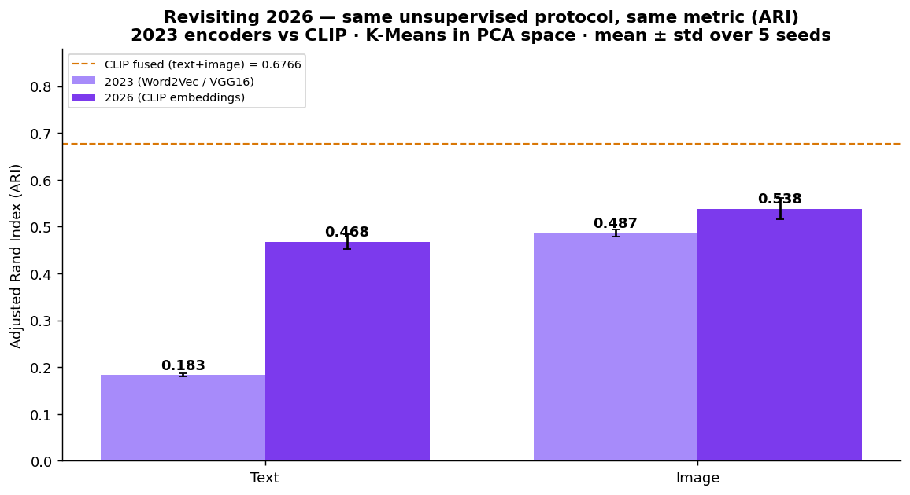
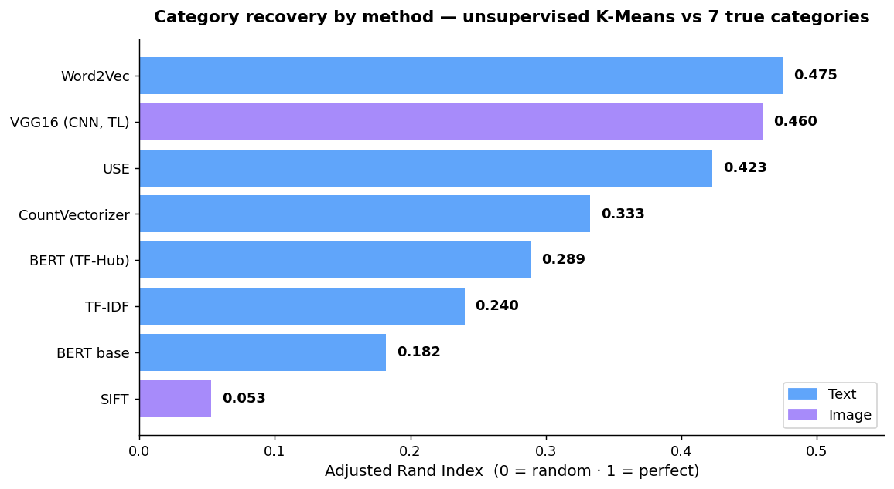
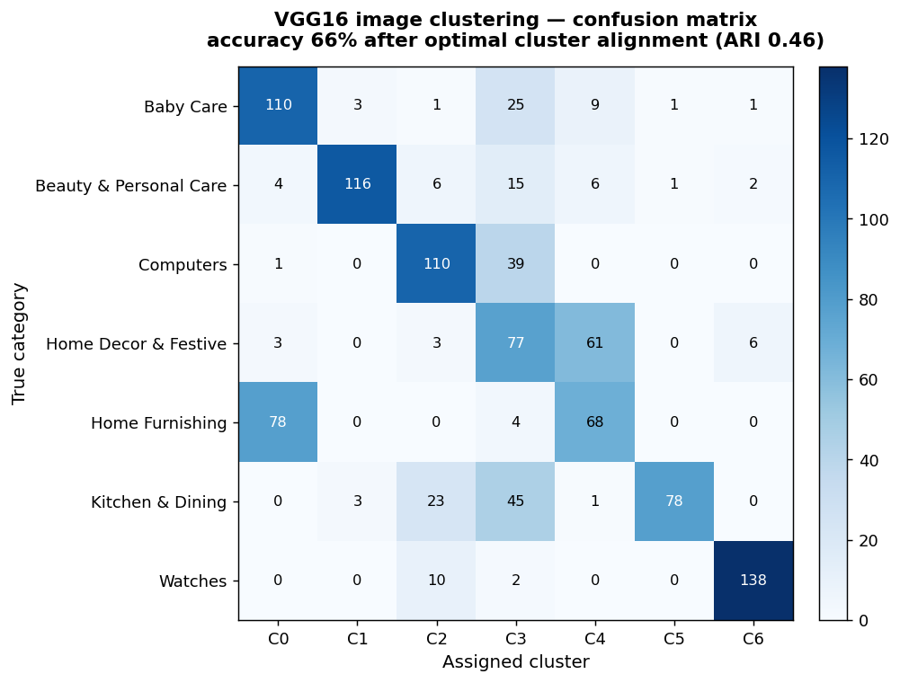
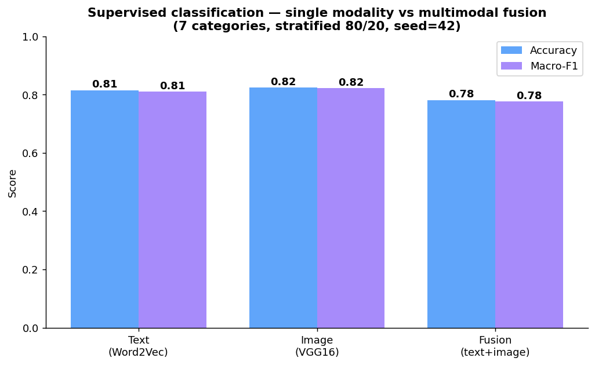
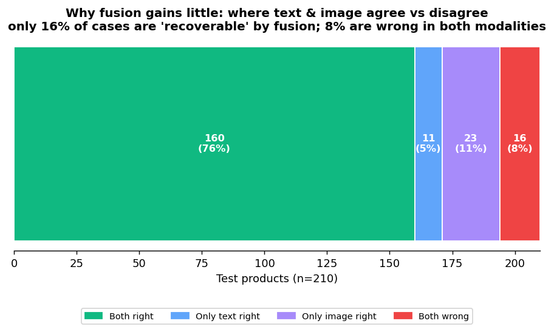
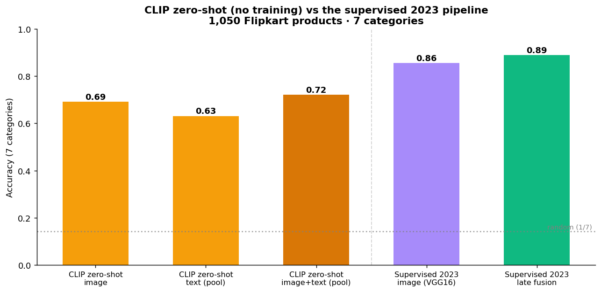

# Multimodal Product Classification — NLP + Computer Vision

> Can a product's **category** be recovered automatically from its text description and its photo — with no manual labelling?
> A feasibility study comparing **6 text** and **2 image** feature-extraction methods on 1,050 Flipkart products — then supervised fusion, and a **2026 CLIP zero-shot** re-run.


*OpenClassrooms Data Scientist — Project 6 · 2023*

🇫🇷 [Version française](#-version-française) · 🇬🇧 [English below](#-english)

---

## 🇬🇧 English

### The 30-second summary — one question, three eras

Built in 2023, revisited in 2026. Same question, same 1,050 products, same 7
balanced categories — three regimes, each with *its own* right metric:

| Era · regime | Method | Metric | Score | What it shows |
|---|---|---|:--:|---|
| **2023 · unsupervised** | Word2Vec (text) / VGG16 (image) | ARI | 0.475 / 0.460 | how much category signal each source carries, no labels |
| **2023 · supervised** | VGG16+SVM / late fusion | Accuracy · macro-F1 | 0.876 / 0.881 | how well we can actually classify, with labels |
| **2026 · revisit (CLIP)** | CLIP zero-shot, one shared space | *both* (below) | ARI 0.674 · Acc 0.716 | what newer tech buys — measured two ways |

**How to read this — and what you may NOT compare.** Accuracy and ARI are
different metrics on different regimes; putting "0.475 (2023)" next to "0.716
(2026)" would be meaningless. Below, every comparison is **like-for-like**:

- **Did the tech improve on *my 2023 method*?** → compare **ARI to ARI**, same
  unsupervised protocol. CLIP embeddings: **text 0.475 → 0.631, image 0.460 →
  0.590** (+0.13 to +0.16). A clean, honest gain.
- **Does zero-shot replace a trained model?** → compare **accuracy to accuracy**.
  CLIP zero-shot 0.716 vs the *trained* 2023 pipeline 0.881. No — but it reaches
  72% with **no training and no labels**.



---

### The question

An e-commerce marketplace lists products that sellers categorise by hand —
slow, inconsistent, error-prone. **Could categories be assigned automatically**
from what we already have: a text description and a photo? This project answers
that *before* building a production classifier, by measuring how much category
signal each data source actually carries.

### Approach — an honest, unsupervised benchmark

Rather than jump to a supervised model, I treated it as a **feasibility study**.
The same protocol is applied to every feature set, so the numbers are directly
comparable:

```
features → PCA (denoise) → t-SNE (2D) → K-Means (k=7) → Adjusted Rand Index
```

The **Adjusted Rand Index (ARI)** scores how well the 7 unsupervised clusters
match the 7 true categories (0 = random, 1 = perfect). No labels are used to
build the features — only to score them.

### Results

| Modality | Method | ARI |
|---|---|:--:|
| Text | CountVectorizer (bag-of-words) | 0.333 |
| Text | TF-IDF | 0.240 |
| **Text** | **Word2Vec** | **0.475** 🏆 |
| Text | BERT (`bert-base-uncased`, [CLS]) | 0.182 |
| Text | BERT (TF-Hub) | 0.289 |
| Text | USE (Universal Sentence Encoder) | 0.423 |
| Image | SIFT (bag-of-visual-words) | 0.053 |
| **Image** | **CNN — VGG16 transfer learning** | **0.460** 🏆 |



> **Why these differ from my 2023 slides (USE 0.49, VGG16 0.47).** Back then I
> didn't fix the random seeds, so the numbers moved every run — and the "best"
> text model flipped between runs. With seeds fixed, the stable winner is
> **Word2Vec at 0.475**, not USE. The old 0.49 wasn't better, it was lucky and
> unreproducible. I'll take a number I can reproduce over one I can't.

The best image model, VGG16, is worth a closer look. Clustering alone gives
ARI 0.460; once the clusters are optimally matched to the true categories
(Hungarian assignment), that is a **66% accuracy** — on 7 classes, from images
only, with no supervision. The confusion matrix shows the model confuses exactly
the categories a human would: *Home Furnishing* leaks into *Baby Care* and
*Home Decor* (visually similar textiles and decor), while *Watches* is near-perfect
(138/150).



### What the numbers say

- **Feasibility: yes.** The best text (0.475) and image (0.460) methods both
  recover categories well above chance — with zero manual labelling.
- **Simpler beat heavier on this data.** Word2Vec outscored BERT (0.18–0.29).
  Product descriptions are keyword bags, not sentences, so BERT's contextual
  strength goes unused when frozen. *Match the model to the data, not to the hype.*
- **Transfer learning is the unlock for images.** VGG16 (0.460) vs SIFT (0.053) —
  a ~9× gain. Learned features transfer across domains; hand-crafted ones don't.
- **The two modalities are complementary** (text ≈ image), which is the case for
  fusing them — tested in phase 2 below.

### Phase 2 — supervised classification & fusion

Phase 1 answers *"is the signal there?"*. Phase 2 answers *"how well can we
actually classify?"* — supervised classifiers (Logistic Regression / SVM /
Random Forest), fixed seed, stratified 80/20 split, best model kept per modality,
then two fusion strategies compared.

> **On the choice of metric.** The 7 classes are perfectly balanced (150 products
> each), so accuracy is *not* misleading here and tracks macro-F1 closely. I
> still report **macro-F1 as the reference metric**: it is the right senior
> reflex, and it surfaces a weak class that plain accuracy would hide.

**Two ways to fuse text and image — they are not the same bet:**

- **Early fusion** glues the two feature vectors end to end (concat), then one
  model classifies the whole thing. The catch: text and image features live on
  different scales and densities, so the weak dimensions dilute the strong ones.
  Measured here at **0.829 — below image alone**. Concatenation is not fusion.
- **Late fusion** keeps one classifier per modality and combines their *outputs*
  (at the decision level). Simplest version: average the predicted probabilities.
  Smarter version: let a small model learn how to combine them — that is what the
  *stacking* row does (a meta-classifier on the two models' probabilities).

| Features | Classifier | Accuracy | Macro-F1 |
|---|---|:--:|:--:|
| Text — Word2Vec | LogReg | 0.814 | 0.809 |
| **Image — VGG16** | **SVM** | **0.876** | **0.874** |
| Early fusion (concat features) | LogReg | 0.829 | 0.825 |
| Late fusion (avg of probabilities) | — | 0.881 | 0.876 |
| Weighted fusion (w_text = 0.50) | — | 0.881 | 0.876 |
| Stacking (meta-LogReg on OOF proba) | — | 0.867 | 0.864 |



Four results worth stating plainly — including the one that undercuts the easy
headline:

- **The model sweep pays off.** On images, SVM (0.876) beats Logistic Regression
  (0.824) by 5 points — a reminder not to settle for one classifier.
- **Early fusion hurts relative to the best single modality.** Concatenating
  300-dim text and 200-dim image features hands the classifier 500 dimensions of
  unequal scale and density, dragging accuracy down to 0.829 — *below* image-only
  (0.876). *Fusion is a modelling decision, not an `np.hstack`.*
- **Fusion barely moves the needle — and I won't pretend otherwise.** The best
  fusion (late / weighted, 0.881) edges image-only (0.876) by **half a point —
  one product out of 210**. Stacking actually does *worse* (0.867). On this
  dataset, images already carry most of the signal; adding text buys almost
  nothing.
- **Why so little? The error-overlap analysis answers it.** Text and image are
  both right on 160/210 products and both wrong on 16. Only **34/210 (16%)** are
  cases where exactly one modality is right — the only cases fusion can possibly
  fix. With so little disagreement to exploit, no fusion scheme can gain much.
  This is the honest ceiling, not a tuning failure. See
  [notebook 02](notebooks/02_supervised_fusion.ipynb).



> **Reproducibility note.** The original 2023 study reported slightly different
> ARI values between the slides and the notebook (e.g. USE ≈ 0.49 vs 0.42)
> because random seeds were not fixed. Everything here is **re-run with
> `seed=42` fixed across Word2Vec, PCA, t-SNE, K-Means and the train/test
> split**. One subtlety found while re-running: Word2Vec is only deterministic
> with `workers=1` — with several workers the training order varies and every
> downstream metric drifts ~1 point between runs, even with the seed set. The
> phase-2 numbers above come from the single-worker, fully reproducible run
> ([`results_supervised.json`](results_supervised.json)).

### The 2026 angle — CLIP zero-shot, actually run

The project is from 2023; the field moved fast. Instead of a design note, I
**ran** the modern approach on the same 1,050 products and measured it.

The idea: **CLIP** puts text and image in *one* shared vector space, so the whole
early-vs-late fusion problem disappears — and you can classify **zero-shot**, by
embedding the category *names* and taking the nearest one. No training, no
labels, three lines.

| Approach | Training | Accuracy | Macro-F1 |
|---|:--:|:--:|:--:|
| CLIP zero-shot — text only | none | 0.635 | 0.636 |
| CLIP zero-shot — image only | none | 0.691 | 0.673 |
| **CLIP zero-shot — image + text** | **none** | **0.716** | **0.708** |
| *Supervised 2023 — VGG16 + SVM* | *trained* | *0.876* | *0.874* |
| *Supervised 2023 — late fusion* | *trained* | *0.881* | *0.876* |



**The honest read:** zero-shot CLIP reaches **72%** on 7 classes **without a
single labelled example** — and ~16 points behind the *trained* 2023 pipeline
(88%). So CLIP does not beat a supervised model here; what it buys is **no
training, no labelled data, and multimodal fusion for free** (a mean in the
shared space). For a cold-start catalogue with no labels, 72% out of the box is a
very different cost/benefit than collecting a training set. See
[notebook 03](notebooks/03_modern_2026_approach.ipynb) and
[`src/run_clip_zeroshot.py`](src/run_clip_zeroshot.py).

**Like-for-like with 2023 — the comparison that is actually fair.** Accuracy vs
ARI across regimes would be apples to oranges. So I re-scored CLIP on the **exact
2023 unsupervised protocol** (features → PCA → t-SNE → K-Means k=7 → ARI,
`random_state=6`), nothing else changed:

| Unsupervised regime (ARI) | 2023 | 2026 — CLIP |
|---|:--:|:--:|
| Text | Word2Vec 0.475 | **0.631** |
| Image | VGG16 0.460 | **0.590** |
| Text + image (shared space) | *n/a in 2023* | **0.674** |

Same metric, same pipeline, same data: CLIP embeddings lift ARI by **+0.16 (text)
and +0.13 (image)**. *This* is what revisiting with 2026 tech buys on my own
method — a real, measurable gain, not a metric swap. And fusion (0.674) is now a
plain average in one shared space, where 2023 needed the whole early-vs-late
study.

**A real limitation, stated plainly:** CLIP's text encoder is capped at **77
tokens**; Flipkart descriptions run up to ~700, so the text side is truncated and
loses information — part of why text-only zero-shot (0.635) trails image-only.

What I'd **keep** from 2023: the fair shared protocol, fixed seeds, a held-out
test set, and reporting negative results honestly. Modern models change the
*tools*, not the *rigour*.

### Tech stack

**NLP** — NLTK (tokenise, stop-words, Porter stemming, WordNet lemmatisation),
scikit-learn (CountVectorizer, TF-IDF), gensim (Word2Vec), Hugging Face
Transformers (BERT), TensorFlow Hub (USE).
**Computer Vision** — OpenCV (SIFT), TensorFlow / Keras (VGG16 transfer learning).
**ML & viz** — scikit-learn (PCA, t-SNE, K-Means, ARI), pandas, matplotlib, seaborn.
**2026 multimodal** — Sentence-Transformers / CLIP (`clip-ViT-B-32`), PyTorch (zero-shot).

### Repository structure

```
p6-product-classification-nlp-cv/
├── README.md                                   # this file
├── requirements.txt                            # pinned dependencies
├── LICENSE                                      # MIT
├── results_supervised.json                     # phase-2 metrics (reproducible)
├── results_clip_zeroshot.json                  # 2026 CLIP zero-shot metrics
├── notebooks/
│   ├── 01_product_classification_text_image.ipynb   # phase 1 — unsupervised benchmark
│   ├── 02_supervised_fusion.ipynb                   # phase 2 — supervised + fusion
│   └── 03_modern_2026_approach.ipynb                # phase 3 — CLIP zero-shot (2026)
├── src/
│   ├── run_supervised.py                       # phase-2 pipeline (seed=42, workers=1)
│   └── run_clip_zeroshot.py                    # phase-3 CLIP zero-shot pipeline
├── data/
│   └── README.md                               # how to fetch the dataset (not versioned)
└── docs/
    ├── articles/README.md                      # references (the 2025 paper, cited)
    ├── *.html                                  # rendered notebooks (read without Jupyter)
    └── figures/                                # charts used in this README
```

### Reproduce

```bash
python -m venv .venv && source .venv/bin/activate
pip install -r requirements.txt
# fetch the dataset — see data/README.md
jupyter lab notebooks/01_product_classification_text_image.ipynb
```

> **Note.** Raw images (~1,050 files), the USE/CLIP models and the virtual
> environment are **not** versioned — see [`data/README.md`](data/README.md).
> The showcase notebooks are written to be *read*; HTML renders are in
> [`docs/`](docs/).

### What the 2025 literature says

The approach here isn't a lucky guess. A 2025 study on exactly this problem —
multimodal e-commerce product categorization at scale (271,700 products, 40
platforms) — tested early, late, and attention fusion over RoBERTa, ViT and
**CLIP**, and found **CLIP embeddings with an MLP late-fusion head gave the best
hierarchical F1 (98.59%)**, beating single-modality baselines. Same direction I
landed on at small scale: CLIP as the shared space, late fusion over early. They
also report a deployment trade-off worth keeping in mind — late fusion maxes
accuracy with diverse training data, early fusion generalises better to unseen
platforms. See [References](#references). *(Paper summary rephrased for
licensing compliance.)*

### 🔎 Critical review — what I'd do better

- **Word2Vec isn't fully deterministic even seeded.** I had to force `workers=1`
  to stop metrics drifting ~1 point between runs. Honest fix, but it hides that
  the real variance should be reported as a mean ± std over several seeds, not a
  single number. That's the rigorous version.
- **ARI through t-SNE is fragile.** Clustering on a 2D t-SNE projection is pretty
  but t-SNE is stochastic and distorts global distances. A cleaner protocol would
  cluster in the original (or PCA) space and report t-SNE for *visualisation only*.
- **CLIP text truncated at 77 tokens.** Flipkart descriptions reach ~700 tokens,
  so the text side loses information — part of why text-only zero-shot trails.
  I took the easy truncation instead of chunk-and-pool.
- **Single train/test split.** Fine for a feasibility study, but a 5-fold CV
  would give confidence intervals instead of point estimates.
- **No calibration check.** Late fusion averages probabilities as if both models
  were calibrated. They may not be — a reliability check would make the fusion
  argument airtight.

### 🔜 To-do next

- Report **mean ± std over 5 seeds** for every metric (kills the reproducibility
  caveat above).
- **Fine-tune** a text and a vision backbone end-to-end — likeliest path past the
  ~0.88 image ceiling.
- **CLIP late-fusion MLP head** (as in the 2025 paper) instead of a plain
  probability average, and lift the 77-token cap (chunk-and-pool).
- **5-fold CV + calibration** (reliability diagrams) for honest confidence.
- Scale beyond 1,050 products to confirm the ceiling holds.

### References

- Q. Han et al., *Cross-Platform E-Commerce Product Categorization and
  Recategorization: A Multimodal Hierarchical Classification Approach*, 2025.
  arXiv:[2508.20013](https://arxiv.org/abs/2508.20013) ·
  doi:[10.48550/arXiv.2508.20013](https://doi.org/10.48550/arXiv.2508.20013).
  See [`docs/articles/README.md`](docs/articles/README.md).
- Dataset — [Flipkart products](https://www.kaggle.com/datasets/PromptCloudHQ/flipkart-products) (public, CC0).

---

## 🇫🇷 Version française

### Le résumé en 30 secondes — une question, trois époques

Construit en 2023, revisité en 2026. Même question, mêmes 1 050 produits, mêmes 7
catégories équilibrées — trois régimes, chacun avec *sa* bonne métrique :

| Époque · régime | Méthode | Métrique | Score | Ce que ça montre |
|---|---|---|:--:|---|
| **2023 · non supervisé** | Word2Vec (texte) / VGG16 (image) | ARI | 0,475 / 0,460 | le signal « catégorie » que porte chaque source, sans labels |
| **2023 · supervisé** | VGG16+SVM / late fusion | Accuracy · macro-F1 | 0,876 / 0,881 | à quel point on sait classer, avec labels |
| **2026 · revisite (CLIP)** | CLIP zero-shot, un espace partagé | *les deux* (ci-dessous) | ARI 0,674 · Acc 0,716 | ce qu'apporte la techno récente — mesuré deux fois |

**Comment lire — et ce qu'on ne peut PAS comparer.** Accuracy et ARI sont des
métriques différentes sur des régimes différents ; mettre « 0,475 (2023) » à côté
de « 0,716 (2026) » n'aurait aucun sens. Ci-dessous, chaque comparaison est **à
régime égal** :

- **La techno a-t-elle amélioré *ma méthode de 2023* ?** → comparer **ARI vs
  ARI**, même protocole non supervisé. Embeddings CLIP : **texte 0,475 → 0,631,
  image 0,460 → 0,590** (+0,13 à +0,16). Un gain propre et honnête.
- **Le zero-shot remplace-t-il un modèle entraîné ?** → comparer **accuracy vs
  accuracy**. CLIP zero-shot 0,716 vs le pipeline 2023 *entraîné* 0,881. Non —
  mais il atteint 72 % **sans entraînement ni labels**.


---

### La question

Une marketplace e-commerce repose sur des catégories saisies à la main par les
vendeurs — lent, incohérent, source d'erreurs. **Peut-on attribuer la catégorie
automatiquement** à partir de ce qu'on a déjà : une description texte et une
photo ? Ce projet y répond *avant* de construire un classifieur de production,
en mesurant la quantité de signal « catégorie » que porte chaque source.

### Démarche — un benchmark non supervisé, honnête

Plutôt que de foncer sur un modèle supervisé, j'ai traité le sujet comme une
**étude de faisabilité**. Le même protocole est appliqué à chaque jeu de
features, pour que les chiffres soient directement comparables :

```
features → PCA (débruitage) → t-SNE (2D) → K-Means (k=7) → Adjusted Rand Index
```

L'**Adjusted Rand Index (ARI)** mesure l'accord entre les 7 clusters non
supervisés et les 7 vraies catégories (0 = aléatoire, 1 = parfait). Aucun label
ne sert à construire les features — seulement à les évaluer.

### Résultats

| Modalité | Méthode | ARI |
|---|---|:--:|
| Texte | CountVectorizer (sac de mots) | 0,333 |
| Texte | TF-IDF | 0,240 |
| **Texte** | **Word2Vec** | **0,475** 🏆 |
| Texte | BERT (`bert-base-uncased`, [CLS]) | 0,182 |
| Texte | BERT (TF-Hub) | 0,289 |
| Texte | USE (Universal Sentence Encoder) | 0,423 |
| Image | SIFT (sac de mots visuels) | 0,053 |
| **Image** | **CNN — VGG16 transfer learning** | **0,460** 🏆 |


> **Pourquoi ça diffère de mes slides 2023 (USE 0,49, VGG16 0,47).** À l'époque
> je ne figeais pas les seeds : les chiffres bougeaient à chaque run, et le
> « meilleur » modèle texte changeait d'un run à l'autre. Seeds figés, le gagnant
> stable est **Word2Vec à 0,475**, pas USE. Le vieux 0,49 n'était pas meilleur,
> il était chanceux et non reproductible. Je préfère un chiffre que je peux
> refaire à l'identique à un chiffre que je ne peux pas réexpliquer.

Le meilleur modèle image, VGG16, mérite un zoom. Le clustering seul donne
ARI 0,460 ; une fois les clusters alignés de façon optimale sur les vraies
catégories (affectation hongroise), cela correspond à **66% d'accuracy** — sur
7 classes, à partir des images seules, sans supervision. La matrice de confusion
montre que le modèle confond exactement les catégories qu'un humain confondrait :
*Home Furnishing* déborde sur *Baby Care* et *Home Decor* (textiles et déco
visuellement proches), tandis que *Watches* est quasi parfait (138/150).


### Lecture des résultats

- **Faisabilité : oui.** Les meilleures méthodes texte (0,475) et image (0,460)
  retrouvent les catégories bien au-dessus du hasard — sans aucun étiquetage
  manuel.
- **Le simple bat le lourd sur ces données.** Word2Vec dépasse BERT (0,18–0,29).
  Les descriptions produits sont des sacs de mots-clés, pas des phrases : la force
  contextuelle de BERT, utilisé gelé, ne sert à rien. *On choisit le modèle selon
  la donnée, pas selon la mode.*
- **Le transfer learning débloque l'image.** VGG16 (0,460) vs SIFT (0,053) — un
  gain d'environ 9×. Les features apprises se transfèrent, pas les features
  artisanales.
- **Les deux modalités sont complémentaires** (texte ≈ image) — fusion testée en
  phase 2 ci-dessous.

### Phase 2 — classification supervisée & fusion

La phase 1 répond à *« le signal existe-t-il ? »*. La phase 2 répond à
*« à quel point sait-on classer ? »* — des classifieurs supervisés (régression
logistique / SVM / Random Forest), seed figé, split stratifié 80/20, meilleur
modèle retenu par modalité, puis deux stratégies de fusion comparées.

> **Sur le choix de la métrique.** Les 7 classes sont parfaitement équilibrées
> (150 produits chacune), donc l'accuracy n'est *pas* trompeuse ici et colle de
> près au macro-F1. Je garde malgré tout le **macro-F1 comme métrique de
> référence** : c'est le bon réflexe de senior, et il révèle une classe faible
> que l'accuracy seule masquerait.

**Deux façons de fusionner texte et image — ce ne sont pas le même pari :**

- **Early fusion** : on colle les deux vecteurs de features bout à bout (concat),
  puis un seul modèle classe le tout. Le piège : texte et image sont à des
  échelles et densités différentes, donc les dimensions faibles diluent les
  fortes. Mesuré ici à **0,829 — sous l'image seule**. Concaténer n'est pas
  fusionner.
- **Late fusion** : un classifieur par modalité, puis on combine leurs *sorties*
  (au niveau décision). Version simple : moyenner les probabilités. Version plus
  maligne : laisser un petit modèle apprendre à les combiner — c'est ce que fait
  la ligne *stacking* (un méta-classifieur sur les probabilités des deux modèles).

| Features | Classifieur | Accuracy | Macro-F1 |
|---|---|:--:|:--:|
| Texte — Word2Vec | LogReg | 0,814 | 0,809 |
| **Image — VGG16** | **SVM** | **0,876** | **0,874** |
| Early fusion (concat features) | LogReg | 0,829 | 0,825 |
| Late fusion (moyenne des probabilités) | — | 0,881 | 0,876 |
| Weighted fusion (w_texte = 0,50) | — | 0,881 | 0,876 |
| Stacking (méta-LogReg sur proba OOF) | — | 0,867 | 0,864 |


Quatre résultats à énoncer franchement — y compris celui qui casse le titre
facile :

- **Le balayage de modèles paie.** Sur l'image, le SVM (0,876) bat la régression
  logistique (0,824) de 5 points — on ne se contente pas d'un seul classifieur.
- **L'early fusion fait pire que la meilleure modalité seule.** Concaténer 300
  dims texte et 200 dims image donne 500 variables d'échelles et densités
  inégales et fait tomber l'accuracy à 0,829 — *sous* l'image seule (0,876).
  *Une fusion est un choix de modélisation, pas un `np.hstack`.*
- **La fusion ne gagne presque rien — et je ne vais pas prétendre le contraire.**
  La meilleure fusion (late / weighted, 0,881) dépasse l'image seule (0,876) de
  **un demi-point — un produit sur 210**. Le stacking fait même *moins bien*
  (0,867). Sur ce jeu, l'image porte déjà l'essentiel du signal ; ajouter le
  texte n'apporte quasiment rien.
- **Pourquoi si peu ? L'analyse d'overlap d'erreurs le dit.** Texte et image ont
  tous deux raison sur 160/210 produits, tous deux tort sur 16. Seuls
  **34/210 (16 %)** sont des cas où une seule modalité a raison — les seuls que
  la fusion peut corriger. Avec si peu de désaccord à exploiter, aucune fusion ne
  peut gagner beaucoup. C'est le plafond honnête, pas un échec de réglage. Voir
  [notebook 02](notebooks/02_supervised_fusion.ipynb).


> **Note de reproductibilité.** L'étude originale de 2023 affichait des valeurs
> d'ARI différentes entre les slides et le notebook (ex. USE ≈ 0,49 vs 0,42)
> car les seeds n'étaient pas figés. Tout ici est **ré-exécuté avec `seed=42`
> figé** (Word2Vec, PCA, t-SNE, K-Means, split train/test). Subtilité trouvée au
> ré-run : Word2Vec n'est déterministe qu'avec `workers=1` — à plusieurs workers
> l'ordre d'entraînement varie et chaque métrique aval bouge d'environ 1 point
> d'un run à l'autre, seed pourtant figé. Les chiffres de la phase 2 ci-dessus
> viennent du run mono-worker, entièrement reproductible
> ([`results_supervised.json`](results_supervised.json)).

### L'angle 2026 — CLIP zero-shot, vraiment exécuté

Le projet date de 2023 ; le domaine a beaucoup bougé. Plutôt qu'une note de
conception, j'ai **exécuté** l'approche moderne sur les mêmes 1 050 produits et
je l'ai mesurée.

L'idée : **CLIP** place texte et image dans *un seul* espace vectoriel partagé,
donc tout le problème early-vs-late fusion disparaît — et on peut classer en
**zero-shot**, en encodant les *noms* de catégories et en prenant le plus proche.
Sans entraînement, sans labels, en trois lignes.

| Approche | Entraînement | Accuracy | Macro-F1 |
|---|:--:|:--:|:--:|
| CLIP zero-shot — texte seul | aucun | 0,635 | 0,636 |
| CLIP zero-shot — image seule | aucun | 0,691 | 0,673 |
| **CLIP zero-shot — image + texte** | **aucun** | **0,716** | **0,708** |
| *Supervisé 2023 — VGG16 + SVM* | *entraîné* | *0,876* | *0,874* |
| *Supervisé 2023 — late fusion* | *entraîné* | *0,881* | *0,876* |


**Lecture honnête :** le zero-shot CLIP atteint **72 %** sur 7 classes **sans un
seul exemple étiqueté** — mais reste ~16 points derrière le pipeline 2023
*entraîné* (88 %). Donc CLIP ne bat pas un modèle supervisé ici ; ce qu'il
apporte, c'est **zéro entraînement, zéro donnée étiquetée, et la fusion
multimodale gratuite** (une moyenne dans l'espace partagé). Pour un catalogue en
démarrage à froid sans labels, 72 % immédiats changent radicalement le rapport
coût/bénéfice face à la collecte d'un jeu d'entraînement. Voir
[notebook 03](notebooks/03_modern_2026_approach.ipynb) et
[`src/run_clip_zeroshot.py`](src/run_clip_zeroshot.py).

**À régime égal avec 2023 — la comparaison réellement juste.** Accuracy vs ARI
entre régimes serait comparer des choux et des carottes. J'ai donc ré-évalué CLIP
sur le **protocole non supervisé exact de 2023** (features → PCA → t-SNE →
K-Means k=7 → ARI, `random_state=6`), rien d'autre changé :

| Régime non supervisé (ARI) | 2023 | 2026 — CLIP |
|---|:--:|:--:|
| Texte | Word2Vec 0,475 | **0,631** |
| Image | VGG16 0,460 | **0,590** |
| Texte + image (espace partagé) | *inexistant en 2023* | **0,674** |

Même métrique, même pipeline, mêmes données : les embeddings CLIP gagnent
**+0,16 (texte) et +0,13 (image)** d'ARI. *Voilà* ce qu'apporte la revisite avec
la techno 2026 sur ma propre méthode — un gain réel et mesurable, pas un
changement de métrique. Et la fusion (0,674) n'est plus qu'une moyenne dans un
espace partagé, là où 2023 nécessitait toute l'étude early-vs-late.

**Une vraie limite, dite franchement :** l'encodeur texte de CLIP est plafonné à
**77 tokens** ; les descriptions Flipkart montent à ~700, donc le côté texte est
tronqué et perd de l'information — en partie pourquoi le zero-shot texte seul
(0,635) est le plus faible.

Ce que je **garde** de 2023 : le protocole partagé équitable, les seeds figés, un
jeu de test tenu à part, et l'honnêteté sur les résultats négatifs. Les modèles
modernes changent les *outils*, pas la *rigueur*.

### Stack technique

**NLP** — NLTK (tokenisation, stop-words, stemming Porter, lemmatisation
WordNet), scikit-learn (CountVectorizer, TF-IDF), gensim (Word2Vec), Hugging Face
Transformers (BERT), TensorFlow Hub (USE).
**Computer Vision** — OpenCV (SIFT), TensorFlow / Keras (VGG16 transfer learning).
**ML & viz** — scikit-learn (PCA, t-SNE, K-Means, ARI), pandas, matplotlib, seaborn.
**Multimodal 2026** — Sentence-Transformers / CLIP (`clip-ViT-B-32`), PyTorch (zero-shot).

### Reproduire

```bash
python -m venv .venv && source .venv/bin/activate
pip install -r requirements.txt
# récupérer le dataset — voir data/README.md
jupyter lab notebooks/01_product_classification_text_image.ipynb
```

> **Note.** Les images brutes (~1 050 fichiers), les modèles USE/CLIP et
> l'environnement virtuel ne sont **pas** versionnés — voir
> [`data/README.md`](data/README.md). Les notebooks sont pensés pour être *lus* ;
> les rendus HTML sont dans [`docs/`](docs/).

### Ce que dit la littérature 2025

La démarche ici n'est pas un coup de chance. Une étude de 2025 sur exactement ce
problème — catégorisation multimodale de produits e-commerce à grande échelle
(271 700 produits, 40 plateformes) — a testé les fusions early, late et attention
sur RoBERTa, ViT et **CLIP**, et trouvé que **CLIP avec une tête de late fusion
MLP donne le meilleur F1 hiérarchique (98,59 %)**, devant les baselines
mono-modalité. Même direction que celle où j'ai atterri à petite échelle : CLIP
comme espace partagé, late fusion plutôt qu'early. Ils notent aussi un arbitrage
de déploiement utile — la late fusion maximise l'accuracy avec des données
d'entraînement variées, l'early fusion généralise mieux à des plateformes
inconnues. Voir [Références](#références). *(Résumé de l'article reformulé pour
conformité aux licences.)*

### 🔎 Retour critique — ce que j'aurais pu mieux faire

- **Word2Vec n'est pas vraiment déterministe, même seedé.** J'ai dû forcer
  `workers=1` pour stopper la dérive de ~1 point entre runs. Correctif honnête,
  mais la vraie rigueur serait de reporter une **moyenne ± écart-type sur
  plusieurs seeds**, pas un chiffre unique.
- **L'ARI via t-SNE est fragile.** Clusteriser sur une projection t-SNE 2D est
  joli, mais t-SNE est stochastique et déforme les distances globales. Plus
  propre : clusteriser dans l'espace d'origine (ou PCA), et garder t-SNE pour la
  *visualisation* seulement.
- **Texte CLIP tronqué à 77 tokens.** Les descriptions Flipkart montent à ~700,
  le texte perd de l'info — en partie pourquoi le zero-shot texte seul est en
  retrait. J'ai pris la troncature facile plutôt qu'un chunk-and-pool.
- **Un seul split train/test.** OK pour une étude de faisabilité, mais une
  validation croisée 5-fold donnerait des intervalles de confiance.
- **Pas de vérif de calibration.** La late fusion moyenne les probabilités comme
  si les deux modèles étaient calibrés. Un diagramme de fiabilité rendrait
  l'argument fusion imparable.

### 🔜 To-do next

- Reporter **moyenne ± écart-type sur 5 seeds** pour chaque métrique (règle le
  point reproductibilité ci-dessus).
- **Fine-tuner** un backbone texte et un backbone vision de bout en bout — voie
  la plus probable au-delà du plafond ~0,88 de l'image.
- **Tête de late fusion MLP CLIP** (comme l'article 2025) au lieu d'une simple
  moyenne de probabilités, et lever le plafond 77 tokens (chunk-and-pool).
- **5-fold CV + calibration** (diagrammes de fiabilité) pour une confiance
  honnête.
- Passer à l'échelle au-delà de 1 050 produits pour confirmer le plafond.

### Références

- Q. Han et al., *Cross-Platform E-Commerce Product Categorization and
  Recategorization: A Multimodal Hierarchical Classification Approach*, 2025.
  arXiv:[2508.20013](https://arxiv.org/abs/2508.20013) ·
  doi:[10.48550/arXiv.2508.20013](https://doi.org/10.48550/arXiv.2508.20013).
  Voir [`docs/articles/README.md`](docs/articles/README.md).
- Dataset — [Flipkart products](https://www.kaggle.com/datasets/PromptCloudHQ/flipkart-products) (public, CC0).

---

*Dataset: [Flipkart products](https://www.kaggle.com/datasets/PromptCloudHQ/flipkart-products) (public, CC0). Built for the OpenClassrooms Data Scientist path, revisited in 2026.*
